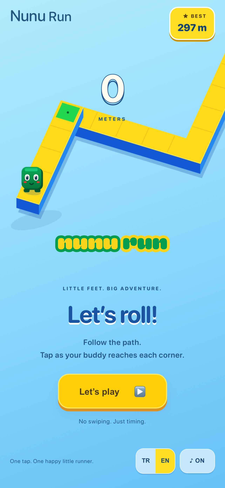
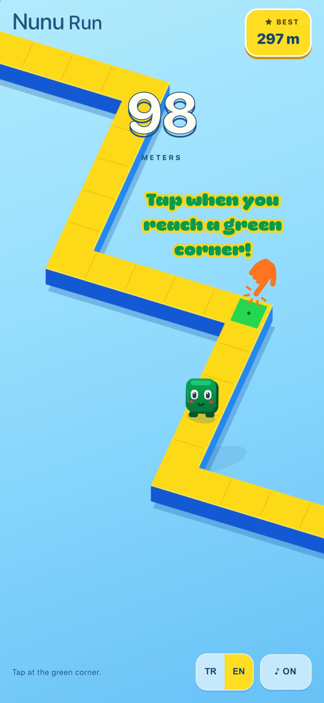
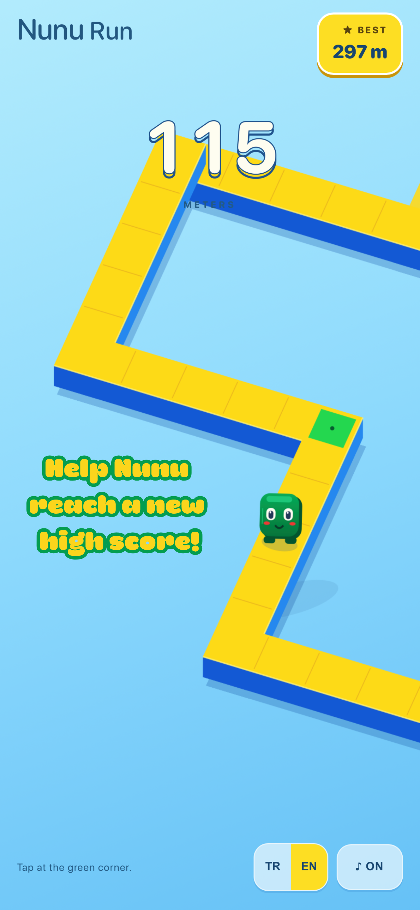

# Nunu Run

**One-touch endless runner for iOS**

Nunu Run is a fast, colorful casual mobile game taken from initial gameplay concept and prototype through production hardening, App Store review, and public iOS release. The player taps at the right moment to help Nunu turn at corners, stay on the path, and survive as the game gradually speeds up.

**[View Nunu Run on the App Store](https://apps.apple.com/tr/app/nunu-run/id6815031710?l=tr)**

## Showcase

  
  
  

## Product Ownership & Game Design

- Defined the core one-touch gameplay loop and score-based progression
- Designed and iterated the corner-turning mechanic, speed curve, and difficulty progression
- Improved first-time user experience through an interactive tutorial flow
- Tuned gameplay readability through visual contrast, interaction feedback, and character presentation
- Defined the retry and failure loop to keep sessions fast and repeatable
- Balanced player experience and monetization by placing interstitial ads outside active gameplay
- Added Turkish and English localization plus music and sound controls
- Took the product from concept and prototype through physical-device QA, TestFlight, App Store review, and public release

## Product Decisions

### Onboarding
A guided first-time tutorial was introduced to teach the core timing mechanic inside the game flow instead of relying on lengthy instructions.

### Difficulty Curve
Speed progression was tuned iteratively so early gameplay remains accessible while the challenge increases continuously over longer runs.

### Player Feedback
Visual, audio, and interaction feedback were used to make successful turns, failures, scores, and retry states immediately understandable.

### Monetization
Interstitial frequency was structured around gameplay failures and shown after Retry rather than interrupting an active run.

## Product Highlights

- One-touch turning mechanic
- Procedural endless gameplay
- Progressive speed and difficulty
- First-time interactive tutorial
- Persistent high score and settings
- Turkish and English localization
- Music and sound controls
- Interstitial monetization flow
- Consent-aware advertising setup for supported regions
- Native iOS release

## Tech Stack

`JavaScript` · `Vite` · `Capacitor` · `iOS` · `AdMob` · `Google UMP`

## Iteration & Validation

The product was refined through repeated hands-on playtesting and physical-device validation, with attention to:

- first-session clarity
- timing and difficulty progression
- retry friction
- visual readability
- score persistence and settings
- background / foreground lifecycle behavior
- localization and audio behavior
- monetization timing
- release readiness

The public release does not claim large-scale player-data analysis or production A/B testing. Those remain future validation layers as meaningful live usage data accumulates.

## From Prototype to Live App Store Release

The project was taken through a complete mobile product and release workflow, including:

- gameplay concept and rapid prototyping
- iterative mechanic and difficulty tuning
- native iOS packaging with Capacitor
- physical-device QA and lifecycle testing
- TestFlight distribution
- App Store metadata, privacy, age-rating, and review preparation
- App Review iteration and release management
- AdMob production setup
- Google User Messaging Platform consent flow
- localization and release hardening
- public App Store distribution

## Current Status

**Live on the App Store**

[Download Nunu Run on the App Store](https://apps.apple.com/tr/app/nunu-run/id6815031710?l=tr)

## Developer Website

[ozankazbas.github.io](https://ozankazbas.github.io)

---

This repository is a public product showcase. The production game source code is kept private.
